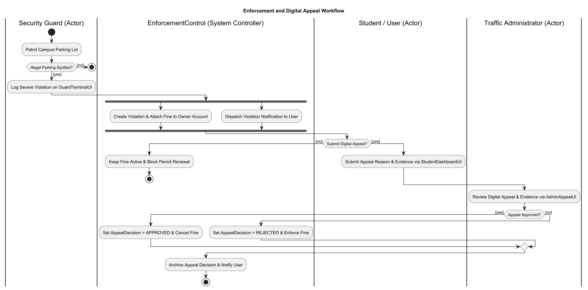
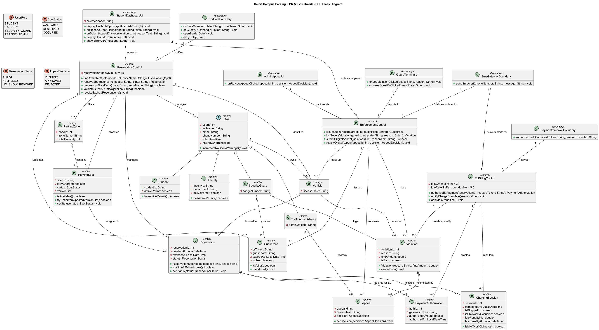
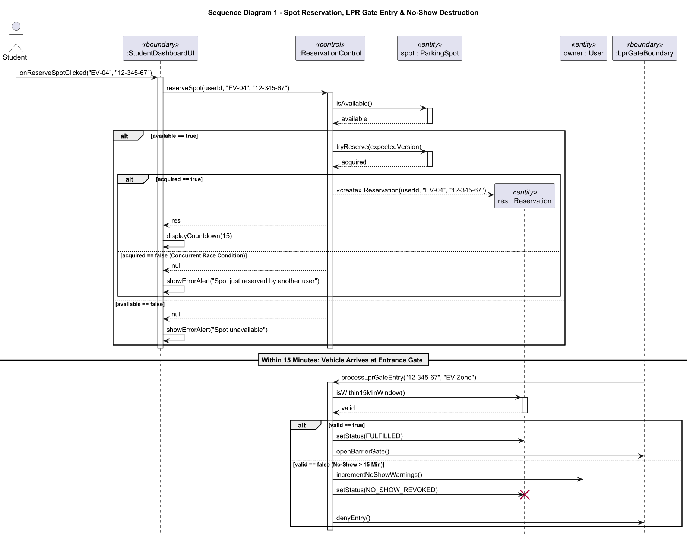
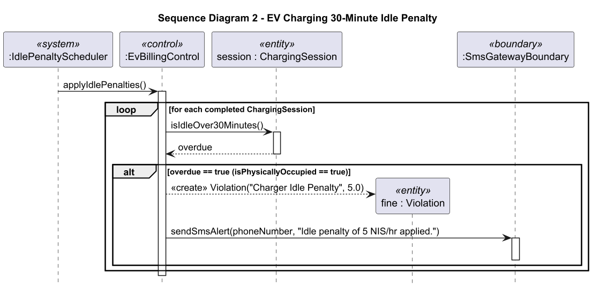

# System Architecture & Object-Oriented Design (`Ex4_SmartParking_Design`)

**Course:** 61756 Software Engineering Methods (Academic Year 2026-2027)
**Institution:** ORT Braude College of Engineering | Department of Software Engineering
**Domain:** Smart Campus Parking, LPR, and EV Network (Continued from Exercise 1)

---

## 1. Engineering Team Details

| Role | Full Name | Student ID | Braude Academic Email |
| :--- | :--- | :--- | :--- |
| **Student A (Role A)** | `[Enter Student A Full Name]` | `[Enter ID]` | `[studentA@e.braude.ac.il]` |
| **Student B (Role B)** | `[Enter Student B Full Name]` | `[Enter ID]` | `[studentB@e.braude.ac.il]` |

* **Group Number:** `G[XX]`
* **GitHub Repository URL:** `https://github.com/[Username]/Ex4_SmartParking_Design`

---

## 2. Step 1: Business Process Modeling — Activity Diagram (`Visual Paradigm`)

* **PlantUML Source:** [`diagrams/activity_appeal.puml`](diagrams/activity_appeal.puml)
* **Visual Paradigm Model:** [`SystemModel_Ex4.vpp`](SystemModel_Ex4.vpp)
* **Partitions / Swimlanes:** Separates external **Actors** (`Security Guard`, `Student / User`, `Traffic Administrator`) from the internal **System Controller** (`EnforcementControl`), using `initial node`, `fork`/`join` (AND), `decision` (XOR) with explicit `[guards]`, `merge` (OR), and `activity final node`.



---

## 3. Step 2: Structural Modeling — ECB Class Diagram (`PlantUML` -> `Visual Paradigm`)

Following the **ECB (Entity-Control-Boundary)** architectural pattern:

| ECB Stereotype | Classes in System | Architectural Responsibility |
| :--- | :--- | :--- |
| **`<<boundary>>`** | `StudentDashboardUI`, `GuardTerminalUI`, `AdminAppealUI`, `LprGateBoundary`, `PaymentGatewayBoundary`, `SmsGatewayBoundary` | Interfaces with external Actors and external hardware/payment/SMS systems. Communicates ONLY with `<<control>>` classes. |
| **`<<control>>`** | `ReservationControl`, `EvBillingControl`, `EnforcementControl` | Multiple specialized controllers orchestrating business rules, timers, concurrency checks, and workflows. |
| **`<<entity>>`** | `User` (`Student`, `Faculty`, `SecurityGuard`, `TrafficAdministrator`), `GuestPass`, `Vehicle`, `ParkingZone`, `ParkingSpot`, `Reservation`, `PaymentAuthorization`, `ChargingSession`, `Violation`, `Appeal` + 4 UML `enum`s | Passive domain data classes storing persistent business state and domain helper methods. |

### 3.1 Controller Responsibilities

| Controller | Responsibilities | Connected Boundaries | Connected Entities |
| :--- | :--- | :--- | :--- |
| `ReservationControl` | Zone-filtered spot search, 15-minute reservations, atomic `tryReserve` concurrency check, LPR gate entry, guest QR validation, No-Show revocation | `StudentDashboardUI`, `LprGateBoundary` | `User`, `Vehicle`, `ParkingZone`, `ParkingSpot`, `Reservation`, `GuestPass` |
| `EvBillingControl` | EV credit-card pre-authorization, 100% charge SMS, 30-minute idle penalty (5 NIS/hour) | `PaymentGatewayBoundary`, `SmsGatewayBoundary` | `PaymentAuthorization`, `ChargingSession`, `Violation` |
| `EnforcementControl` | Guest QR issuing, Severe Violation logging, digital appeal submission and review | `GuardTerminalUI`, `AdminAppealUI`, `StudentDashboardUI`, `SmsGatewayBoundary` | `Vehicle`, `GuestPass`, `Violation`, `Appeal` |

### 3.2 Relationship Rules Applied

* **Inheritance (the only arrow):** `User <|-- Student`, `Faculty`, `SecurityGuard`, `TrafficAdministrator`.
* **Aggregation (hollow diamond):** `ParkingZone "1" o-- "1..*" ParkingSpot` — spots exist independently of the zone.
* **Composition (filled diamond):** `Reservation *-- PaymentAuthorization`, `Reservation *-- ChargingSession`, `Violation *-- Appeal` — parts cannot exist without the whole.
* **Association (plain line):** `User "1" -- "0..*" Vehicle` — deleting a user does not destroy the physical vehicle.
* Zero `-->` and zero `..>` arrows; no `<<boundary>>` class is linked to an `<<entity>>` class.

* **PlantUML Source:** [`diagrams/class_diagram_ecb.puml`](diagrams/class_diagram_ecb.puml)
* **Visual Paradigm Model:** [`SystemModel_Ex4.vpp`](SystemModel_Ex4.vpp)



---

## 4. Step 3: Behavioral Modeling — ECB Sequence Diagrams (`PlantUML` -> `Visual Paradigm`)

### 4.1 Sequence Diagram 1: Spot Reservation, LPR Gate Entry & No-Show Destruction
* **PlantUML Source:** [`diagrams/sequence_reservation_ecb.puml`](diagrams/sequence_reservation_ecb.puml)



### 4.2 Sequence Diagram 2: EV Charging 30-Minute Idle Penalty (`loop` & `<<create>>`)
* **PlantUML Source:** [`diagrams/sequence_idle_penalty_ecb.puml`](diagrams/sequence_idle_penalty_ecb.puml)



### 4.3 Cross-Diagram Consistency Check (Iterative Refinement)

| Message in Sequence Diagram | Target Class | Declared in Class Diagram |
| :--- | :--- | :--- |
| `onReserveSpotClicked(spotId, plate)`, `displayCountdown(minutes)`, `showErrorAlert(message)` | `StudentDashboardUI` | Yes |
| `reserveSpot(userId, spotId, plate)`, `processLprGateEntry(plate, zoneName)` | `ReservationControl` | Yes |
| `isAvailable()`, `tryReserve(expectedVersion)` | `ParkingSpot` | Yes |
| `<<create>> Reservation(userId, spotId, plate)`, `isWithin15MinWindow()`, `setStatus(status)` | `Reservation` | Yes (constructor added during refinement) |
| `incrementNoShowWarnings()` | `User` | Yes |
| `openBarrierGate()`, `denyEntry()` | `LprGateBoundary` | Yes |
| `applyIdlePenalties()` | `EvBillingControl` | Yes |
| `isIdleOver30Minutes()` | `ChargingSession` | Yes |
| `<<create>> Violation(reason, fineAmount)` | `Violation` | Yes (constructor added during refinement) |
| `sendSmsAlert(phoneNumber, message)` | `SmsGatewayBoundary` | Yes |

**Refinements made to the Class Diagram while modeling the Sequence Diagrams:**
1. Added constructor `Reservation(userId: int, spotId: String, plate: String)` to match the `<<create>>` message in Sequence 1.
2. Added constructor `Violation(reason: String, fineAmount: double)` to match the `<<create>>` message in Sequence 2.
3. Added the call `owner.incrementNoShowWarnings()` in the No-Show branch of Sequence 1 (required by Section 2.2 of `SYSTEM_STORY.md`).

---

## 5. Independent AI Prompt & Architectural Design Critique (Part 4)

```text
You are a senior software architect reviewing a UML 2.5 design. Use the attached
SYSTEM_STORY.md, diagrams/class_diagram_ecb.puml and diagrams/sequence_reservation_ecb.puml.
Audit the design strictly against the two edge cases in Section 3 of SYSTEM_STORY.md:

Edge Case A (Double-Booking Race Condition): Two students click "Reserve" on the last
available spot in the Student Zone at the exact same millisecond.
Edge Case B (Physical vs. Electrical EV State): An EV driver unplugs the charging cable
at minute 29 but does not physically move the car out of the EV bay.

For each edge case:
1. State whether the current Class Diagram has the attributes and operations needed to
   handle it (check ParkingSpot.version, ParkingSpot.tryReserve(expectedVersion),
   ChargingSession.isPluggedIn and ChargingSession.isPhysicallyOccupied).
2. State whether Sequence Diagram 1 shows the correct alt branches for the failure path.
3. List any missing attribute, operation, multiplicity or message, quoting the exact
   class and method name.
4. Suggest at most 3 concrete improvements that keep the ECB rules (boundary talks only
   to control, only inheritance uses an arrow in the Class Diagram).
Answer as a numbered list. Do not rewrite the whole diagram.
```

* **Improvement 1 Applied (Race Condition):** Added `version: int` and `tryReserve(expectedVersion: int): boolean` on `ParkingSpot` (and nested `alt acquired == true/false` in Sequence Diagram 1) to prevent simultaneous double-booking. Only the request whose `expectedVersion` still matches wins; the other receives "Spot just reserved by another user".
* **Improvement 2 Applied (EV Physical Occupancy):** Separated `isPluggedIn` from `isPhysicallyOccupied` on `ChargingSession` so unplugging the cable at minute 29 without moving the car still triggers the 30-minute Charger Idle Penalty. `isIdleOver30Minutes()` checks `isPhysicallyOccupied`, not `isPluggedIn` (shown as the `alt` guard in Sequence Diagram 2).
* **Additional Improvement (suggested by the AI review):** Added `lastPenaltyAt: LocalDateTime` to `ChargingSession` so the periodic `IdlePenaltyScheduler` charges the 5 NIS penalty at most once per hour and does not create a duplicate `Violation` on every scheduler run.

---

## 6. License
Distributed under the **ORT Braude College Academic License** (61756 Software Engineering Methods, 2026-2027).
